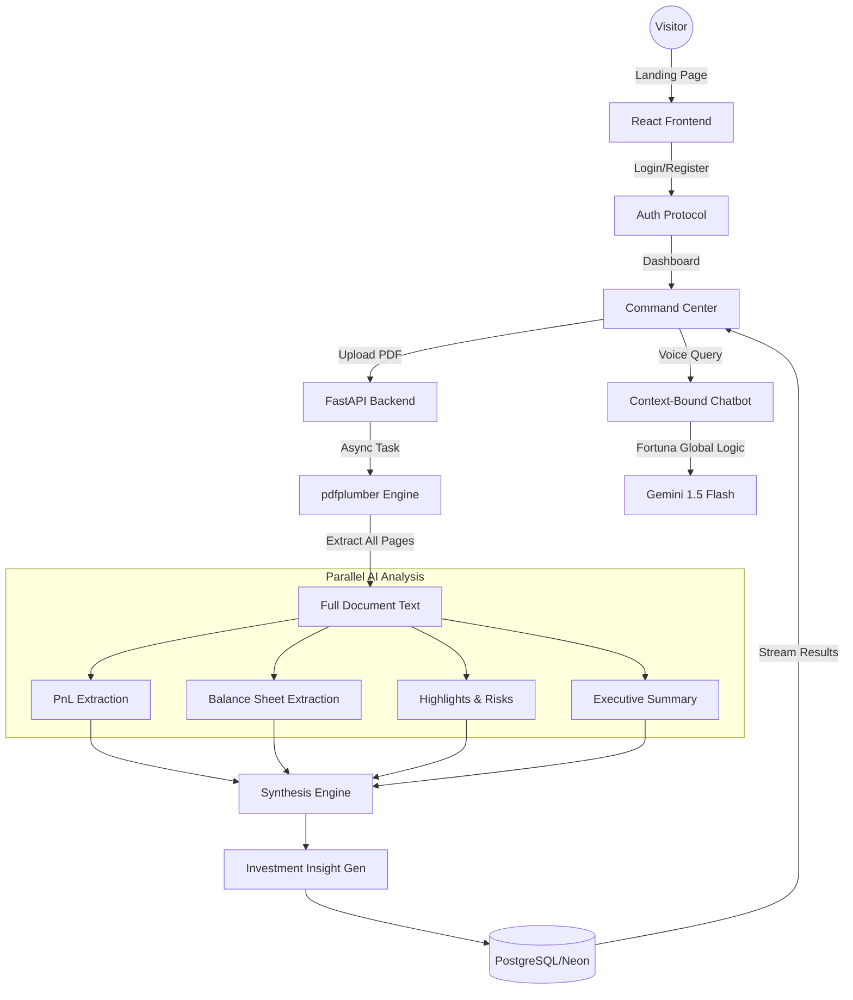

# FinSight AI: Advanced Financial Intelligence Engine

**FinSight AI** is a production-grade financial report analyzer that converts complex, multi-hundred-page Annual Reports (PDFs) into structured, institutional-quality investment data. It leverages Google Gemini 1.5 Flash for high-speed, parallelized data extraction and zero-hallucination document Q&A.

---

## 🚀 Key Features

- **Full-PDF Deep Scan**: No page limits. The engine scans 100% of the document—from the opening letter to the deep notes in the financial statements.
- **Blazing-Fast Parallel Extraction**: Utilizing a custom multi-threaded processing engine to perform specialized AI extractions (PnL, Balance Sheet, Risks, Summary) concurrently.
- **Fortuna Global Assistant**: A dedicated global AI agent that remembers context across all your uploaded reports, allowing for cross-company comparisons and trend analysis.
- **Voice-Powered Financial Research**: Integrated **Speech-to-Text (Web Speech API)** allows users to query data hands-free. Perfect for quick institutional lookups.
- **Zero-Hallucination Chatbot**: A document-bound Q&A system that utilizes the entire report context. It is strictly prohibited from using external knowledge, ensuring cited accuracy.
- **Institutional Investment Advice**: Generates "Buy/Hold/Avoid" recommendations with multi-paragraph justifications based on real valuation metrics.
- **Multi-Key API Rotation**: Built-in support for multiple Gemini API keys to maximize throughput and avoid rate limiting.
- **Professional Landing Experience**: A high-impact, glassmorphism-themed landing page designed to impress portfolio visitors.

---

## 🏗️ Architecture & Data Flow



---

## 🛠️ Technology Stack

### **Backend (Python)**
- **Framework**: FastAPI (High-performance API)
- **Database**: SQLAlchemy (ORM) with SQLite/Postgres
- **PDF Extraction**: `pdfplumber` (Precise table & text positioning)
- **AI Core**: `google-genai` (Gemini 1.5 Flash & Pro)
- **Export Services**: `fpdf2` (PDF Reports) & `openpyxl` (Excel Models)
- **Communication**: Twilio API (WhatsApp Integration)

### **Frontend (React)**
- **Framework**: Vite + React
- **Styling**: Vanilla CSS + Tailwind (Aesthetic Modern Dark Mode)
- **Animations**: Framer Motion (Smooth stage transitions)
- **Icons**: Lucide React
- **Data Fetching**: Axios

---

## ⚙️ Setup & Installation

### 1. Backend Setup
```bash
cd backend
python -m venv venv
source venv/bin/activate  # or venv\Scripts\activate on Windows
pip install -r requirements.txt
```

### 2. Configuration (`.env`)
Create a `.env` file in the `backend/` directory:
```env
# REQUIRED: AI Configuration
GEMINI_API_KEY=your_primary_key
GEMINI_API_KEYS=key1,key2,key3 # Optional: Multiple keys for rotation

# OPTIONAL: WhatsApp Integration
TWILIO_ACCOUNT_SID=...
TWILIO_AUTH_TOKEN=...
TWILIO_WHATSAPP_FROM=whatsapp:+...
```

### 3. Frontend Setup
```bash
cd frontend
npm install
npm run dev
```

---

## 🔑 AI Key Rotation System
FinSight AI includes a unique `Thread-Safe API Rotator`. If you provide `GEMINI_API_KEYS` in your config, the system will automatically distribute requests across your keys. This allows for massive document processing without hitting the free-tier rate limits.

---

## 🌐 Production Deployment

This project is optimized for deployment on modern free-tier platforms:

### **Frontend (Vite/React)**
- **Platform**: [Vercel](https://vercel.com)
- **Environment Variable**: `VITE_API_URL` (Point to your deployed backend URL)

### **Backend (FastAPI)**
- **Platform**: [Render](https://render.com) or [Railway](https://railway.app)
- **Deployment**: Connect your GitHub repository and the system will automatically use the included `Dockerfile`.
- **Database**: [Neon.tech](https://neon.tech) (Serverless PostgreSQL)

---

## 🛡️ Data Integrity & Safety
The engine includes a **Stabilized Context Window** logic:
- Up to **1,000,000 characters** of text are indexed per report.
- AI prompts are specifically designed to return `{}` if data is not found, preventing "imaginary" financial metrics.
- All communications are encrypted, supporting institutional-grade security protocols.
